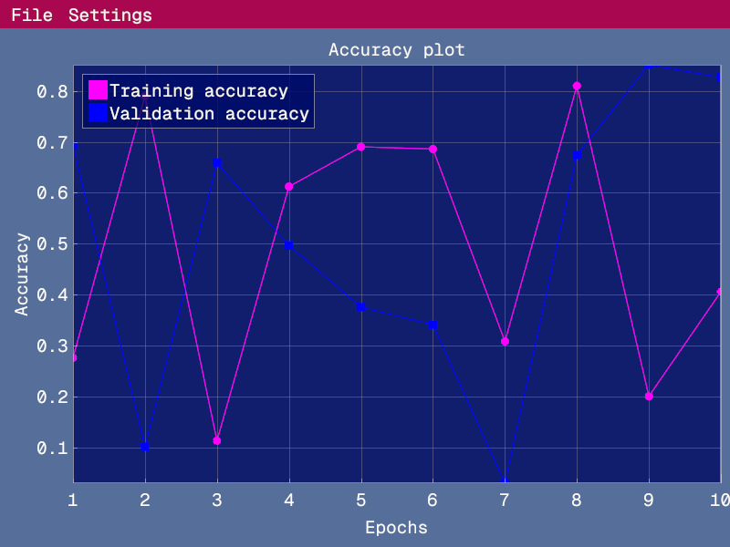
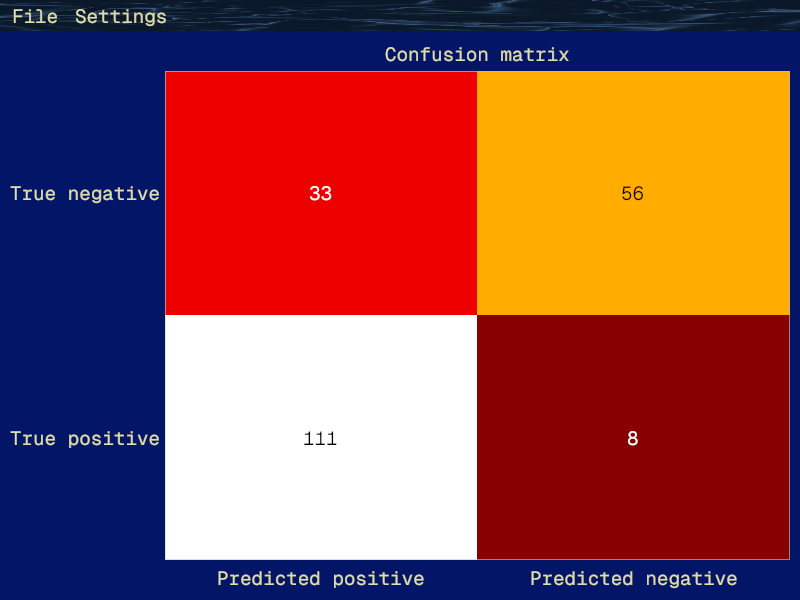
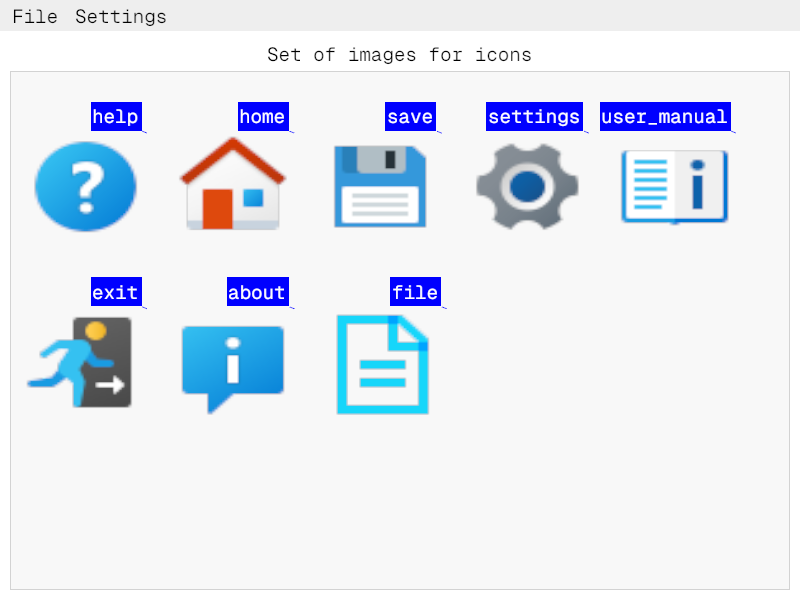
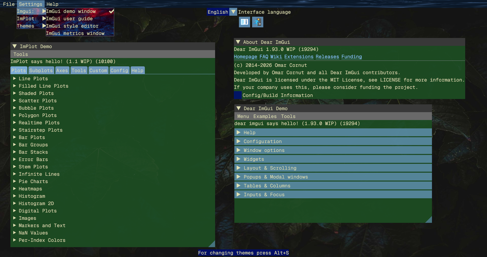

# About Vudiplot library

## Screenshots

  

  

  

  


## Description

Vudiplot is a simple C++ library for visualization.  
It supports only a three kinds of plots line plot, heatmaps and image plot for now.  
There is also a demo mode where user can launch demo windows
from Dear ImGui and ImPlot to learn possibilities of the libraries.  
Please read the user's guide for detailed information.  


## Features

  * It draws plots based on user's data.
  * An user can save a screenshot of a plot.
  * It has demo mode for learning Dear ImGui and Implot.
  * It supports localization through gettext and .po files.

## How to use

To start using this library:  
	**First method:**  
	
 - Copy the repository to yours project root directory.
 - Extract all archived runtime dependencies from libs/Linux/ to the same directory.
 - Add a folder with Vudiplot library to yours CMake file through add_subdirectory(Vudiplot library folder).
 - Link the library target_link_libraries(${PROJECT_NAME} PRIVATE vudiplot).
 
    **Second method:**  

 - Download release and extract it.
 - Add Vudiplot to yours CMakeLists.txt as shared library:  
 ```cmakelists
   set(VUDIPLOT "${CMAKE_SOURCE_DIR}/Vudiplot_Linux_x86_64")  
   add_library(vudiplot SHARED IMPORTED)  
   set_target_properties(vudiplot PROPERTIES  
	IMPORTED_LOCATION "${VUDIPLOT}/libvudiplot.so"  
	INTERFACE_INCLUDE_DIRECTORIES "${VUDIPLOT}/include"  
  )  
  ```
 - Link the library target_link_libraries(${PROJECT_NAME} PRIVATE vudiplot).
 
 Code example for a line plot:  

```cpp
#include <cstdlib>
#include <Vudiplot.hpp>
#include <random>

auto generate_random_data(const size_t count) -> std::vector<double>
{
    // Generate random data for the line plot
    std::vector<double> y_arr;
    y_arr.reserve(count);
    std::random_device rand_dev;

    std::mt19937 rand_eng(rand_dev());
    std::uniform_real_distribution<double> dist(0.0, 1.0);

    for (size_t i = 0; i < count; ++i) {
        auto number { dist(rand_eng) };
        y_arr.emplace_back(number);
    }

    return y_arr;
}

auto main() -> int
{
    // Instance of the Vudiplot class
    auto vudiplot { Vudiplot<VudiInit::LinePlot>() };

    // epochs is a data for x axis.
    // It's a line plot for two line
    // therefore it has two sets of data for x and y axes.
	// Data for x axis of both lines are same in this case.
    std::vector<double> epochs(10);
    std::iota(epochs.begin(), epochs.end(), 1);

    // It's a struct with predefined colors for using in the imgui (ImVec4
    // format)
    VudiInit::VudiplotColors vudiplot_colors;

    // ImPlotSpec is a additional appearance configuration for the line plot in
    // this case
    ImPlotSpec implot_spec_red;
    implot_spec_red.Marker = ImPlotMarker_Circle;
    implot_spec_red.MarkerSize = 4.0f;
    implot_spec_red.LineColor = vudiplot_colors.purple;

    // It's a structure with all necessary data for initialization of the line
    // plot drawing. Some data are mandatory such as data for x and y axes.
    // Some data can be omitted like axis name or colormap and specs.
    auto line_plot_init = VudiInit::LinePlot(VudiInit::LinePlot());

    line_plot_init.main_plot_name = "Machine learning accuracies";
    line_plot_init.x_axis = { epochs, epochs };
    line_plot_init.x_axis_name = "Epochs";
    line_plot_init.y_axis
        = { generate_random_data(10), generate_random_data(10) };
    line_plot_init.y_axis_name = "Accuracy";
    line_plot_init.legends = { "Training accuracy ", " Validation accuracy " };
    line_plot_init.implot_colormap = ImPlotColormap_Dark;
    line_plot_init.implot_specs = { ImPlotSpec(), implot_spec_red };

    // This function set a plot initialization data to proper template
    // variable. It's a mandatory step.
    if (vudiplot.set_plot_params(line_plot_init)) {
        // This function launch a drawing process and a window with a plot
        // will appears.
        vudiplot.show();
    }
   
    return EXIT_SUCCESS;
}
```
   

## Authors

  - Teg Miles (movarocks2@gmail.com)
  - Icons were taken from https://icons8.com/.
  - Images were taken from https://www.pexels.com/.
  - The font was taken from https://www.nerdfonts.com/.

## Requirements

* CMake (3.28 or newer), C++ compiler (GCC, Clang).
* Vulkan API 1.4, Dear ImGui 1.93, ImPlot 1.1, SDL3 3.4, KTX 5.0.0-rc1,  
Slang 2026.11, glm, lodepng, gettext (already available for OS Linux in folder libs/Linux).
* An installed driver on your system that supports Vulkan API.
* Catch2, gcovr (optionally, if you want to run the tests).

Following operating system:

* **Linux**: x86_64 with kernel 6.8 or higher.  *Manjaro 26 (or newer) recommended.*  
(Vudiplot library was tested on Xubuntu 24.04 and Manjaro 26)

